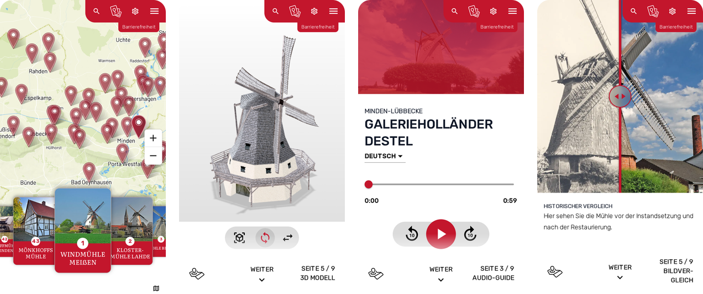

  <picture>
    <source media="(prefers-color-scheme: dark)" srcset="logo-dark.svg">
    
  </picture>

Kommunen, Museen und Vereine zeigen ihre Orte als Web-App mit Audioguide, Karte und Spielen. Besucher öffnen sie per QR-Code im Browser, ohne Installation. Die Inhalte pflegen die Träger selbst.

Hier liegen die Teile von erleben.app, die wir offen weitergeben.

## Mühlen.app

  

Die [Mühlen.app](https://muehlen.app) führt zu historischen Mühlen, angefangen mit den 43 Mühlen im Kreis Minden-Lübbecke. Es gibt sie im Browser, bei [Google Play](https://play.google.com/store/apps/details?id=app.muehlen) und im [App Store](https://apps.apple.com/de/app/id6818328427).

| Repository | Inhalt | Lizenz |
| --- | --- | --- |
| [muehlen-app-android](https://github.com/erleben-app/muehlen-app-android) | Android-App als Trusted Web Activity, mit Store-Texten für Google Play, F-Droid und IzzyOnDroid | Apache 2.0 |

## English

erleben.app builds web apps for towns, museums and associations in Germany: audio guides, maps and games for their sites, opened by QR code in the browser. This organization holds the parts we publish as open source.

## Kontakt

erleben.app ist eine Marke der Seeger & Krämer GbR, Stemwede.
[erleben.app](https://erleben.app) · [info@erleben.app](mailto:info@erleben.app) · [Impressum](https://erleben.app/impressum)
